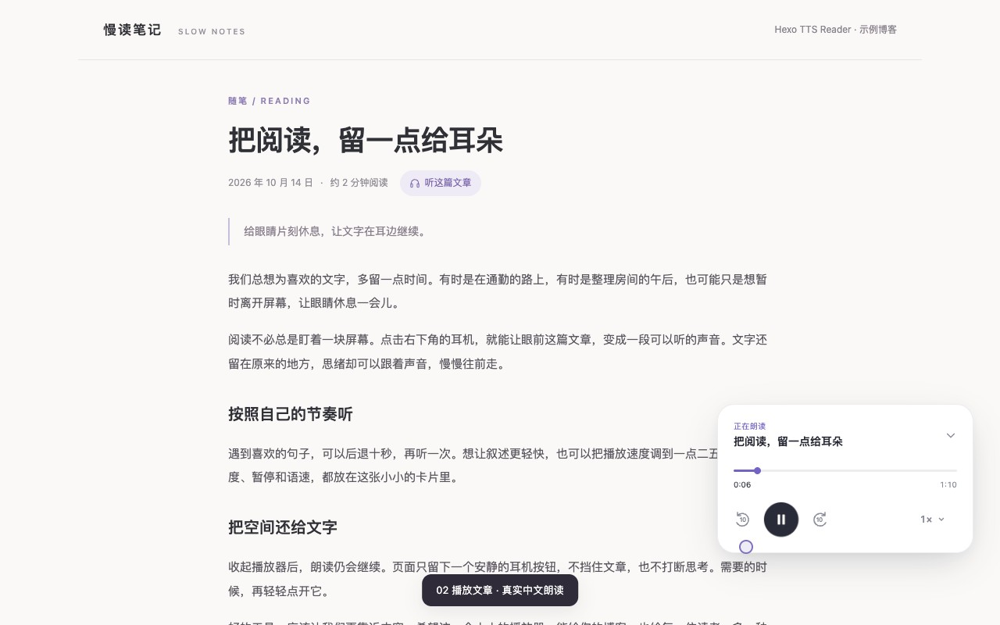

# Article playback demo

This example blog page uses the plugin's real player markup, stylesheet, JavaScript,
and a local Chinese narration generated by the plugin's Edge TTS integration.
The original narration text is in `article.txt`; the complete audio is `article.mp3`.

## Watch

[](./player-demo.mp4)

[Watch the narrated player demo](./player-demo.mp4)

The video demonstrates opening the player, playing the article, switching to
1.25× speed, collapsing the player while playback continues, and pausing.
Its audio was captured from the browser during the interaction recording.
The pointer ring and step captions are recording annotations, not plugin features.

## Try it

From the repository root:

```sh
python3 -m http.server 8080 --bind 127.0.0.1
```

Open <http://127.0.0.1:8080/docs/demo/>. Click the headphone button in the
bottom-right corner, or **听这篇文章** below the article title.
The demo needs no TTS request at playback time; its audio is already included.
